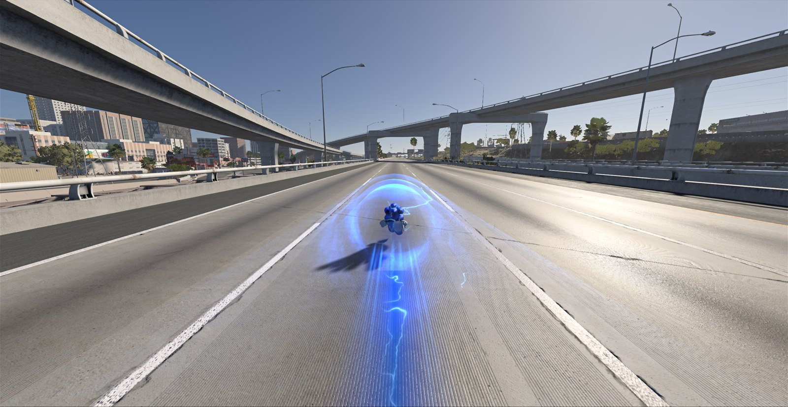
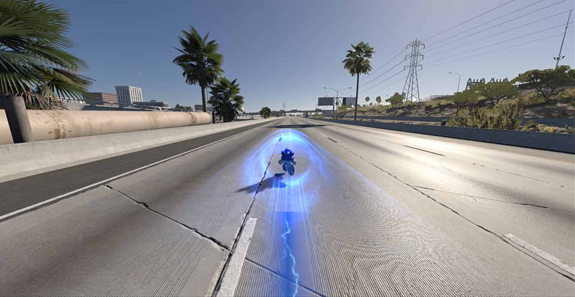
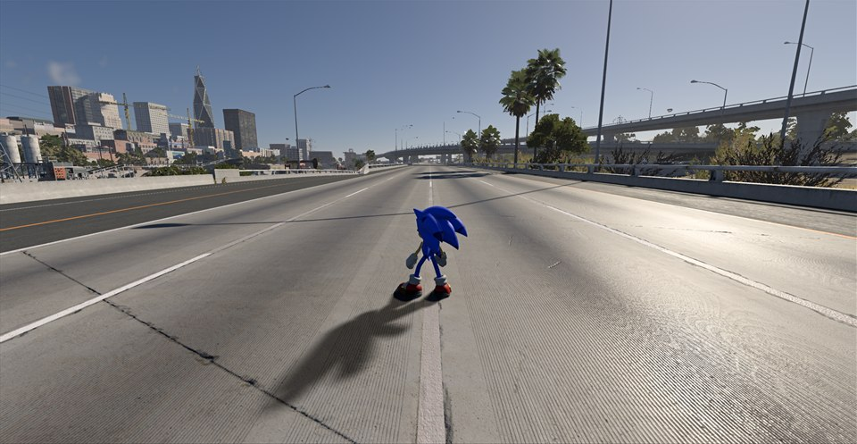

# Sonic Beam



**Run free as the real Sonic from Sonic Frontiers across every BeamNG.drive map**, with an unlimited boost, Frontiers' boost effects and his own sounds.

Load any map in Freeroam and you start on foot as the actual Sonic from Sonic Frontiers: his model, his animations, his sounds and his boost effects, converted on your PC from your own copy of Frontiers. Sonic is a real part of BeamNG's world: BeamNG lights him, he casts his shadow on the real ground and he hides behind walls and trees. No game files are included in this project.

| | |
|---|---|
|  |  |

## Features
- **The real Frontiers Sonic**: his model, textures and every animation he needs (run, boost, drifts, jump ball, air tricks, wall runs, swimming), playing faster as he speeds up.
- **Unlimited boost**: hold Shift and keep accelerating. Set a top speed (or none) in the O menu.
- **Frontiers' boost effects**: the electric-blue boost shell around him, lightning crackling on his body, the Power Boost trail with its lightning arcs, a flash with glowing orbs when the boost kicks in, and a radial speed blur. Effects grow with your speed.
- **His sounds**, played by BeamNG's own audio: footsteps that match the ground (asphalt, dirt, grass, sand, snow, water, metal), jump, boost, landing, brake, speed wind and a sonic boom on fast boosts.
- **His shadow** follows his silhouette and BeamNG's sun.
- **Runs on water**: fast enough, Sonic runs across lakes and the sea; slower, he swims back to the shore.
- **Smashes cars**: hit traffic at speed and the cars fly and crumple. In the Lab, choose whether Sonic loses speed by the car's mass, plows through or bounces off.
- **Runs on walls**: boost into a building or a cliff and Sonic runs up it, or along it when you come in at an angle.
- **Frontiers' jump ball**: Sonic curls into his spinning blue ball when he jumps; choose in the Lab whether he stays a ball or does tricks.
- **BeamNG's cameras on foot**: C cycles through Sonic's chase camera and BeamNG's orbit, external, drone and top-down cameras.
- **Sonic Beam Lab** (O menu, then Lab): tune volumes, boost, aura, shadow, motion blur, water, walls, impacts, jump ball and animation speed. Every setting explains itself when you hover it. Saved between sessions.
- **Unstuck** (U, or in the O menu) puts you back on your feet after a 600 km/h crash into a fence.

## Requirements
- **BeamNG.drive 0.40** on Windows 10 or 11 (64-bit).
- **Sonic Frontiers** for PC, from Steam, Epic or any other copy with its game files, current version with the free updates. It only has to be installed; it does not need to run.

## Install
1. Download **`SonicBeam-Setup-<version>.exe`** from the [Releases](../../releases) page.
2. Close BeamNG.drive and run the setup.
   - It finds your BeamNG.drive user folder and Sonic Frontiers (Steam and Epic). If it can't, click **Browse...** and choose the folder (for Sonic Frontiers, the one that holds `SonicFrontiers.exe`).
   - Click **Install**. It copies the mod and converts Sonic from your Sonic Frontiers in a few seconds.
3. Start BeamNG.drive and load any map in **Freeroam**: you are Sonic. Press **O** for the Sonic Beam menu.

The setup is not code-signed, so Windows may show **"Windows protected your PC"**: click **More info**, then **Run anyway**. If Windows' Smart App Control is turned on, it may block the setup entirely.

**Update**: download the new setup, run it and click **Reinstall**.

**Uninstall**: run the setup again and click **Uninstall**. It removes the mod and Sonic's converted files (it asks whether to keep your Lab settings). Sonic Frontiers, BeamNG.drive and your other mods are never touched.

## Controls
| Key | Action |
|---|---|
| W A S D | Run |
| Shift | Boost |
| Space | Jump |
| Mouse | Camera |
| C | Next camera (Shift+C: free camera) |
| F | Get in or out of a car |
| O | Sonic Beam menu (Sonic mode, top speed, Lab, Unstuck) |
| U | Unstuck |

O and U can be changed in BeamNG's Options > Controls.

## Good to know
- By default Sonic takes over **Freeroam** only; career, scenarios and missions keep BeamNG's normal walking. In the O menu, the Sonic mode **Always** makes him your walker in every game mode (press F to get out of a car), and **Off** turns him off.
- After a Sonic Frontiers update, run the setup again and click **Reinstall** to convert Sonic again.
- The setup writes its log to `%TEMP%\SonicBeamNative-setup.log`.

## How it works
- `natif/mod/` is an ordinary BeamNG mod (Lua and shaders): it puts you on foot as Sonic, drives his walking body with his physics (boost, jumps, walls, water), picks his animations, draws his effects, his shadow and his boost shell, plays his sounds and runs the O menu and the Lab.
- `natif/converter/` reads Sonic from your own Sonic Frontiers (`src/frontiers/`: PAC archives, model, skeleton, ACL animations, DDS textures, ACB/HCA sounds) and writes a BeamNG shape, materials, textures and sounds into your BeamNG user folder. Nothing from Frontiers is ever in this repository or in the setup.
- `natif/installer/` is the setup: one exe that holds the mod and the converter.
- `beamng/` is the earlier overlay version of Sonic Beam (a `version.dll` drawing Sonic over BeamNG's picture). It is no longer developed; its last packages are on the [Releases](../../releases) page. Never install both versions at once.

## Build from source
Windows, PowerShell and Python 3. Put the toolchain in `.tools/` at the repository root:
- `zig-x86_64-windows-0.15.2/` (Zig 0.15.2, used as the C/C++ compiler),
- `PXDAnimationTools-26fd823adcfba9d053b3ad0acac38aa0ae2086a3/` (for the ACL and RTM headers it bundles),
- `luac51.exe` (luac from Lua 5.1.5, used to check the Lua scripts).

Then run:
```
powershell -ExecutionPolicy Bypass -File natif\build.ps1 -Setup
```
It checks the Lua scripts, builds the converter, then writes `natif/build/SonicBeam-Setup-<version>.exe` and prints its SHA256. The version comes from `natif/VERSION`; changes are listed in `natif/CHANGELOG.md`. More in [`natif/README.md`](natif/README.md).

`tools/dev/` holds small developer tools for looking inside Frontiers' files on your own install (they never copy game content into the project).

## Credits & licenses
Sonic Beam is [MIT licensed](LICENSE). It uses:
- [ACL](https://github.com/nfrechette/acl) and [RTM](https://github.com/nfrechette/rtm) by Nicholas Frechette (MIT),
- HedgeLib's knowledge of the Hedgehog Engine formats (MIT),
- vgmstream's clHCA decoder (ISC).

Their licenses are in [`licenses/`](licenses). The license covers only this project's own code. Sonic and Sonic Frontiers are © SEGA. BeamNG.drive is © BeamNG GmbH. This is a fan mod, not affiliated with SEGA or BeamNG. No game files are included: everything is read from your own installs.
