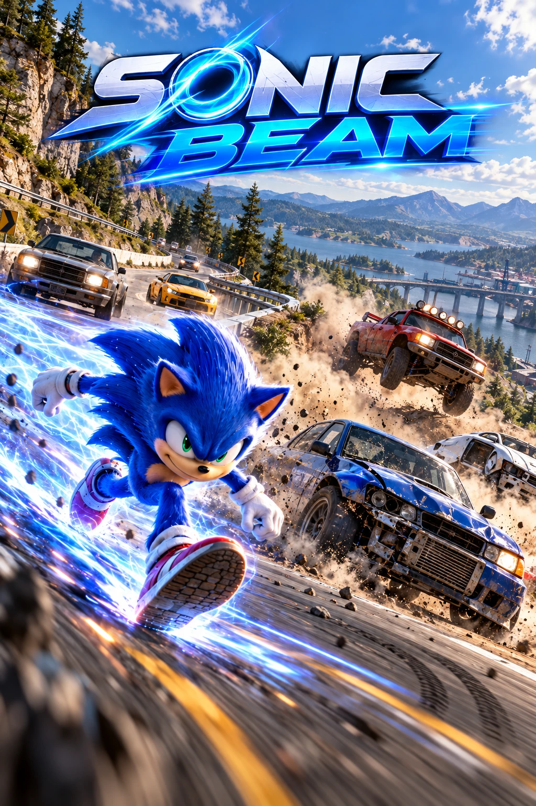
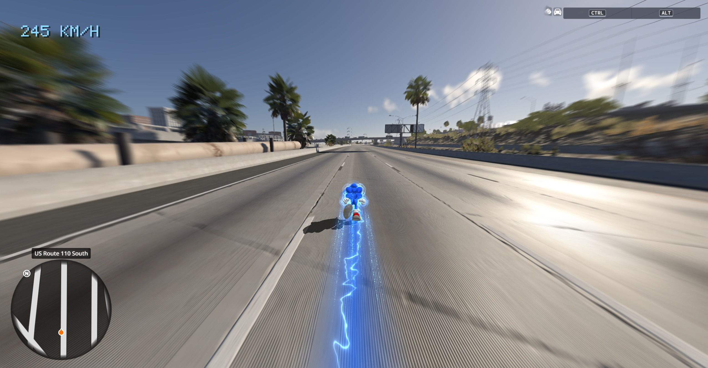
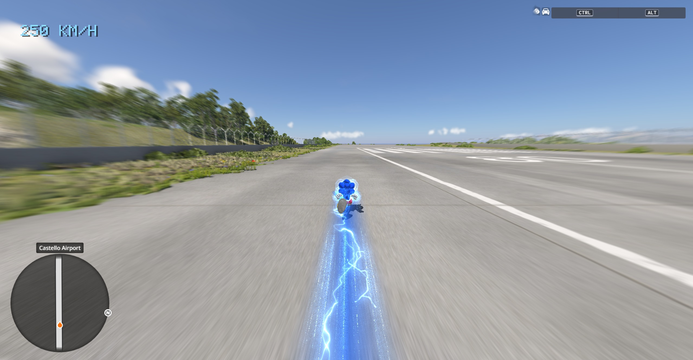

# Sonic Beam



**Run free as the real Sonic from Sonic Frontiers across every BeamNG.drive map**, with an unlimited boost, Frontiers' boost effects and his own sounds.

Load any map in Freeroam and you start on foot as the actual Sonic from Sonic Frontiers: his model, his animations, his sounds and his boost effects, read straight from your own copy of Frontiers. No game files are included in this project.

| | |
|---|---|
|  |  |

## Features
- **Real Frontiers Sonic**: model, textures and animations that speed up with him (run, boost, drifts, jumps, air tricks).
- **Unlimited boost**: hold Shift and keep accelerating. Set a top speed (or none) in the O menu.
- **Frontiers boost effects**: radial speed blur, the blue boost aura, the Power Boost trail with lightning arcs and crackling bolts, and a flash with glowing orbs when the boost kicks in. Effects grow with your speed.
- **His sounds**: footsteps that match the ground (asphalt, dirt, grass, sand, snow, water, metal), jump, boost, landing, brake, speed wind, a sonic boom on fast boosts.
- **A real shadow** that follows his silhouette and BeamNG's sun.
- **Frontiers' jump ball**: Sonic curls up into a spinning blue ball when he jumps, in Frontiers' own spin shell. Choose in the Lab whether he stays a ball, does tricks after the top of the jump, or does a trick when you hold a direction in the air; tune the spin speed, the glow and the jump height.
- **Sonic Beam Lab**: an in-game panel (O menu, then Lab) to tune volumes, shadow, trail, lightning, speed blur, jump ball and animation speed. Saved between sessions.
- **Unstuck** in the O menu puts you back on your feet after a 600 km/h crash into a fence.

## Requirements
- **BeamNG.drive 0.40** (tested on 0.40.0.0, build 287428), Windows, Direct3D 12 or Direct3D 11.
- **Sonic Frontiers** for PC, current version with all free updates (tested on the January 2026 PC build). It only has to be installed; it does not need to run.

## Install
1. Download `SonicBeam-<version>.zip` from the [Releases](../../releases) page.
2. Close BeamNG.drive, unzip the package anywhere and double-click **`install.bat`**.
   - It finds BeamNG.drive and Sonic Frontiers in your Steam libraries, or asks for their folders.
   - It **backs up** every file it would replace (for example another mod's `version.dll`) before installing.
   - If Windows refuses to write into the BeamNG folder, right-click `install.bat` and choose **Run as administrator**.
3. Start BeamNG.drive and load any map in **Freeroam**: you are Sonic.

On the first launch, BeamNG warns about a **"Third-party library"** (`version.dll`, the part that draws Sonic). Click **Cancel** and it won't ask again.

### Uninstall
Close BeamNG.drive and double-click **`uninstall.bat`** in the unzipped folder. It removes every Sonic Beam file and **restores the backed-up files**, so BeamNG is exactly as it was.

### Manual install
1. Copy `sonicfrontiers_sonic` into `%LOCALAPPDATA%\BeamNG\BeamNG.drive\current\mods\unpacked\`.
2. Copy the content of `bin64` (`version.dll` and the `SonicBeam` folder) into BeamNG.drive's `Bin64` folder. Back up any `version.dll` already there.
3. Create `%LOCALAPPDATA%\SonicBeam\settings.ini` with one line pointing to your Sonic Frontiers folder (the one that holds `SonicFrontiers.exe` and `image`), for example:
   ```
   frontiers=D:/Games/Sonic Frontiers
   ```

If you start BeamNG with a custom `-userpath`, put `sonicfrontiers_sonic` in `<userpath>\current\mods\unpacked\` instead.

## Controls
| Key | Action |
|---|---|
| W A S D | Run |
| Shift | Boost |
| Space | Jump |
| Mouse | Camera |
| F | Get in or out of a car |
| O | Sonic Beam menu (top speed, Lab, Unstuck) |

## Good to know
- By default Sonic takes over **Freeroam** only (BeamNG.Earth's map included); career, scenarios, missions and tutorials keep BeamNG's normal walking. In the O menu, **Sonic: Always** makes him your walker in every game mode (he never pulls you out of a car there: get out with F), and **Sonic: Off** turns him off.
- Sonic is drawn on top of BeamNG's picture, so BeamNG's own menus can appear behind him; he hides when a menu is open.

## How it works
- `beamng/mod/` is an ordinary BeamNG mod (Lua): it puts you on foot, drives the walking body with Sonic's physics (boost, glide, jumps), runs the chase camera and the O menu, and sends one small packet per frame (camera, Sonic's body, settings) over a loopback UDP socket.
- `beamng/src/` is `version.dll`, a proxy loaded by BeamNG from `Bin64`. It reads Sonic Frontiers' archives from the player's install (`src/frontiers/`: PAC archives, models, skeletons, ACL animations, DDS textures, ACB/HCA sounds), draws Sonic and the effects over BeamNG's Direct3D 12 or 11 picture, and plays his sounds with XAudio2.
- `beamng/sheets/*.json` hold every number and list (animations, sounds, tuning, physics...). The build checks them and generates code from them.

## Build from source
Windows, PowerShell and Python 3. Put the toolchain in `.tools/` at the repository root:
- `zig-x86_64-windows-0.15.2/` (Zig 0.15.2, used as the C/C++ compiler),
- `PXDAnimationTools-26fd823adcfba9d053b3ad0acac38aa0ae2086a3/` (for the ACL and RTM headers it bundles),
- `luac51.exe` (luac from Lua 5.1.5, used to check the Lua scripts).

Then run:
```
powershell -ExecutionPolicy Bypass -File beamng\build.ps1
```
It runs the sheet preflight, the Lua check, compiles `version.dll` and checks the HLSL shaders, then writes `beamng/build/SonicBeam-<version>.zip`. The version comes from `beamng/VERSION`; changes are listed in `beamng/CHANGELOG.md`.

`tools/dev/` holds small developer tools for looking inside Frontiers' files on your own install (they never copy game content into the project).

## Credits & licenses
Sonic Beam is [MIT licensed](LICENSE). It uses:
- [ACL](https://github.com/nfrechette/acl) and [RTM](https://github.com/nfrechette/rtm) by Nicholas Frechette (MIT),
- HedgeLib's knowledge of the Hedgehog Engine formats (MIT),
- vgmstream's clHCA decoder (ISC).

Their licenses are in [`licenses/`](licenses). Sonic and Sonic Frontiers are © SEGA. BeamNG.drive is © BeamNG GmbH. This is a fan mod, not affiliated with SEGA or BeamNG. No game files are included: everything is read from your own installs.
